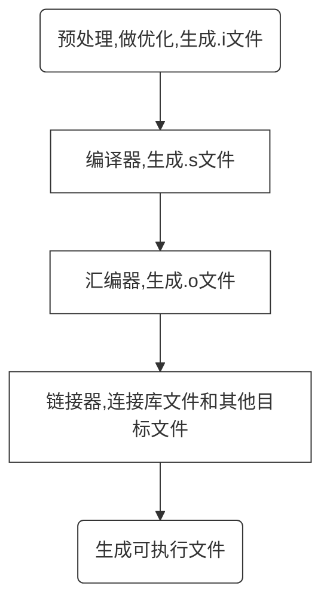

title: C++编译过程
author: SaltedMdFiveSh
tags:
  - C++
categories:
  - C++
date: 2019-08-12 22:26:00
---


#### C++预处理阶段主要完成的工作：

处理#开始的预编译指令： 
（1）宏定义(#define)：对宏定义进行字符串替换。 
（2）文件包含(#include)：文件包含命令把指定头文件插入该命令行位置取代该命令行，从而把指定的文件和当前的源程序文件连成一个源文件。 
（3）条件编译(#ifdef)：当满足某条件时语句进行编译，而当条件不满足时则编译另一组语句。条件编译对程序的移植和调试是很有用的。
```
#ifndef  Linux
	linux平台下运行的函数	
#else
	#ifndef  windows
	Windows平台下运行的函数
	#endif         
#endif
```
#### 汇编阶段：

直接生成了汇编代码

#### 链接器阶段

（1）函数重载：同名函数，不同函数输入变量/输出变量的类型/不同功能。
（2）inline函数：如果函数体不太大，对此函数的所有调用都以函数本体去替代，注意inline只是对编译器的一个建议申请，不是强制命令 
（3）模板处理：函数定义（包括具现化后的函数模板，类模板的成员函数），变量定义（包括函数模板的静态数据变量，类模板的静态数据变量，类模板的全局对象等） 
（4）虚函数：每一个多态class都有一份虚函数表，定义或继承了虚函数的对象会有一个隐含成员：指向虚表的指针vptr，在构造或析构对象的时候，编译器生成的代码会修改这个指针。按道理说，一个多态class的虚表应该恰好被一个目标文件定义，这样链接就不会有错，但c++编译器有时无法判断是否应该在当前编译单元生成虚表定义，为保险起见，只能每个编译单元都生成虚表，然后交给链接器来消除重复数据。

* C++使用的也是C语言的单遍编译的方式，从头到尾扫描一遍源码，一边解析源码，一边即刻生成目标代码
