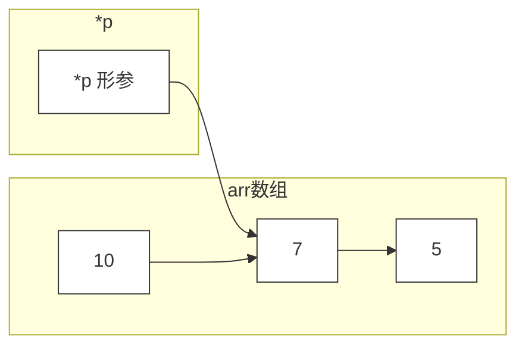
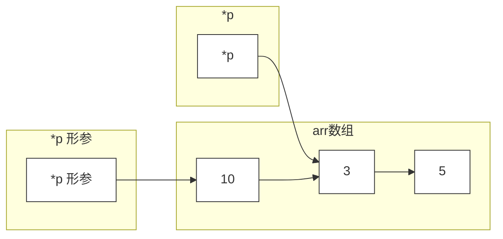
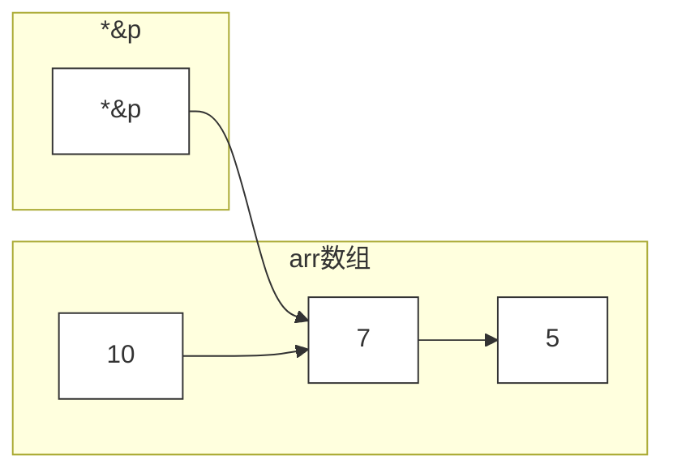
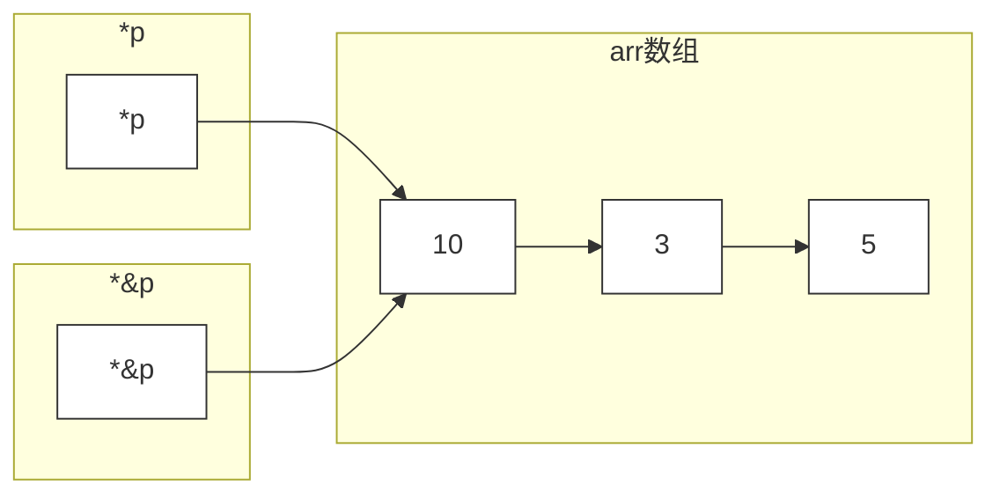

title: 指针的形参
author: SaltedMdFiveSh
tags:
  - C++
categories:
  - C++
date: 2019-08-13 11:11:00
---
---

函数中传递的是p指针的形参（只能修改arr[1]的值，无法修改*p指向的位置）


#### *p形参的情况：

* 一开始:



* 最后:



* 注意：`*p--=3`实际上是`*p=3`，然后`(p--)`

```
#include<iostream>
using namespace std;
int func(int *p){
	return (*p--=3)-1;
}
int main()
{
	int arr[]={10,7,5};
	int *p=arr+1;
	printf("%d",func(p)+*p);
        // 答案为5
}
```


#### *&p引用的情况：

* 一开始:



* 最后:



```
#include<iostream>
using namespace std;
int func(int *&p){
    return (*p--=3)-1;
}
int main()
{
    int arr[]={10,7,5};
    int *p=arr+1;
    printf("%d",func(p)+*p);
        // 答案为12
}
```