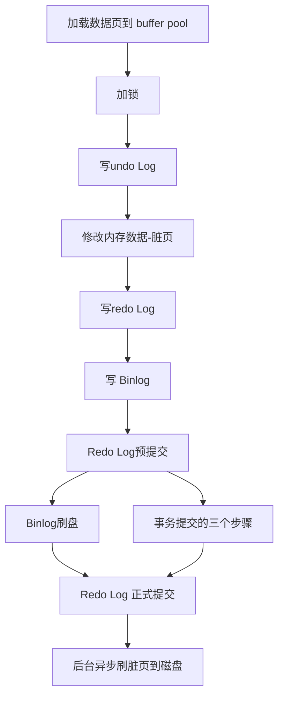

title: Mysql数据库的读写做了什么
author: SaltedMdFiveSh
tags:
  - MYSQL
categories:
  - MYSQL
date: 2026-02-12 17:39:00
---
---

读：解析 - 优化 - 查缓存/磁盘

1.客户端发起 SQL

2.连接器验证权限

3.查询缓存（8.0 已移除）

4.解析器 → 词法 / 语法分析

5.优化器 → 生成执行计划

6.执行器 → 调用存储引擎

7.引擎层

先查 InnoDB 缓冲池（Buffer Pool）

命中：直接返回

不命中：从 磁盘.ibd 文件 加载数据页到内存

8.结果返回客户端

写：

### 写操作 vs 读操作 的CPU占用

写操作需要执行的步骤多，天然烧cpu，还需要记录redo/undo log内外存占用也更多。