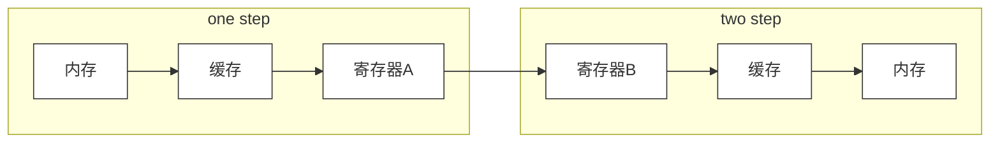

title: about
date: 2019-08-04 22:37:01
---
<center><strong>一个酒吧废物</strong></center>





```flow
st=>start: 开始
e=>end: 结束
op=>operation: 我的操作
cond=>condition: 判断确认？
  
st->op->cond
cond(yes)->e
cond(no)->op
```

do | bird | cat
-|-|-
foo | foo  | foo
bar | bar  | bar
baz | baz  | baz